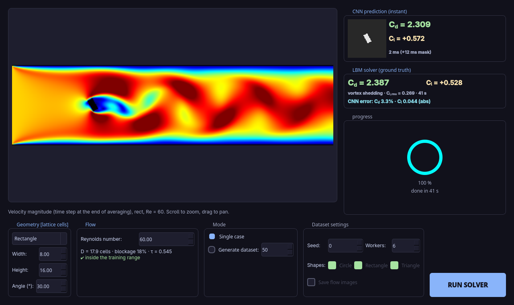
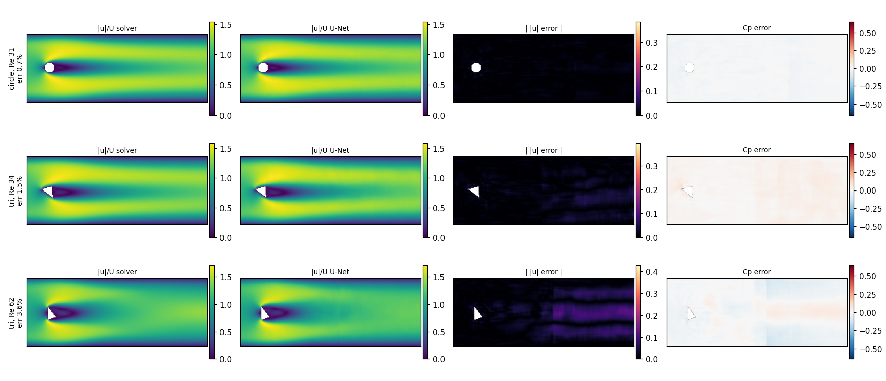
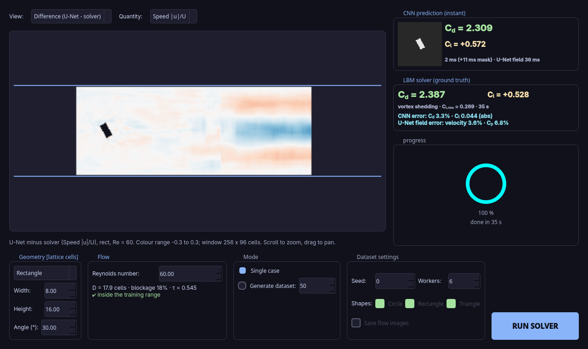

# CFD-Drag-2D: Lattice Boltzmann Solver, Flow Dataset and Neural Surrogates

    

## Overview
A complete, reproducible pipeline from physics to machine learning:

1. **Solver:** a 2D lattice Boltzmann (D2Q9, TRT) flow solver written from scratch in C++ and CUDA,
   validated against the Schäfer–Turek cylinder benchmark.
2. **Dataset:** 5000 random obstacles (circles, rectangles, triangles at any angle, Re 20 to 100)
   solved on two Kaggle T4 GPUs in under an hour, with automatic quality checks.
3. **Surrogate:** a small CNN that predicts drag (Cd) and lift (Cl) from the obstacle shape and Re
   in milliseconds, with a 2.3 % mean Cd error, beating a gradient-boosting baseline that is
   given the exact shape parameters.
4. **Flow-field surrogate (v2):** a U-Net that predicts the whole time-averaged velocity and
   pressure field around the obstacle, trained on the same 5000 cases with stored mean fields.
5. **Flow Studio:** a desktop app to design an obstacle, see the CNN and U-Net predictions
   instantly, and check them against the full simulation.



*Flow Studio, rotated rectangle at Re = 60 (vortex shedding): the CNN predicts Cd = 2.31 and the U-Net
the whole time-averaged flow field (shown) in about 50 ms together; the solver gives Cd = 2.39 after 35 s.
U-Net field error for this case: velocity 3.6 %, Cp 6.8 %.*

## Features
* **CPU and CUDA engines:** both share one per-node update (`cfd_engine/lbm_common.hpp`). The CUDA
  solver runs hundreds of cases per launch and matches the CPU solver to 10 digits.
* **Correct physics inputs:** Reynolds number as input, time-averaged Cd/Cl after warm-up (vortex
  shedding), projected frontal height as reference length, stability and blockage guards.
* **Reproducible dataset pipeline:** seeded per-case sampling, parallel and resumable generation,
  identical results for any worker count or GPU batch size, dataset checks and a CPU spot check.
* **CNN surrogate:** PyTorch, trained on Kaggle GPUs from a notebook that clones this repository;
  evaluated against mean and gradient-boosting baselines over 3 training seeds.
* **U-Net field surrogate:** time-averaged ux, uy and Cp on a 256x96 window around the obstacle,
  compared with mean-field and nearest-neighbour baselines over 3 training seeds.
* **Flow Studio (PyQt6):** live CNN and U-Net predictions with input validation, full solver run,
  side-by-side field views (U-Net, solver, difference), and dataset generation from the GUI.
* **Tested:** 76 tests, including physics validation, determinism, exact mirror symmetry and GPU-vs-CPU agreement.

## Solver
* D2Q9 lattice Boltzmann with TRT collision, half-way bounce-back walls, Zou-He velocity inlet
  (uniform or parabolic) and pressure outlet. The inlet ramps up smoothly from rest.
* Inputs: shape, sizes, angle and **Reynolds number** `Re = U·D/ν`, where `D` is the projected
  frontal height of the rotated obstacle and `U` the mean inlet velocity (0.05 lattice units).
* Outputs (`results.csv` in `--out-dir`): time-averaged **Cd**, **Cl**, lift fluctuation `Cl_rms`,
  pressure loss, a steady/periodic flag, and optionally the mask and flow fields as `.npy`.
* Validated in `tests/`: determinism, mass conservation, channel (Poiseuille) flow, and the
  Schäfer–Turek 2D-1 cylinder benchmark (Cd = 5.58 at Re = 20).
* Options (M10): `--walls freeslip` replaces the no-slip channel walls by free-slip walls (specular
  reflection; cylinder D = 20, Re = 40: Cd 2.84 -> 2.17), and `--precision float` stores the
  populations as float32 deviations from equilibrium weights. Float is **4x faster on a T4**
  (0.18 s instead of 0.71 s per case) and matches double to 2e-6 in Cd on steady cases and 2e-4 on
  vortex-shedding cases. Default walls stay no-slip; the default precision `auto` is float on the
  CUDA back-end and double on the CPU (the published v1/v2 datasets were made in double; pass
  `precision="double"` to reproduce them bit for bit).

## Status
Complete (milestones M0 to M10; v1.0 drag surrogate, v2.0 flow-field surrogate, M10 solver and training extras). See `SPEC.md` for the specification and `DECISIONS.md` for every
design choice and result.

## Prerequisites
* **C++ Compiler:** GCC/G++ with C++17 support, and `make`.
* **Python:** 3.10+ (3.12 recommended). Dependencies are listed in `requirements.txt`.

## Quick Start
All commands run from the repository root.

```bash
# 1. Build the solver (-> build/solver)
make solver

# 2. Python environment
python -m venv .venv && source .venv/bin/activate
pip install -r requirements.txt -e .

# 3. Flow Studio (GUI); the CNN panel needs the [ml] extra (step 8)
python gui/app.py

# 4. CLI dataset generation (resumable; writes to ./dataset by default)
python scripts/generate.py --n 100 --seed 0 --out dataset --images

# 5. Tests (quick; use `make test-all` to include slow validation tests;
#    GPU tests run only where build/solver_cuda and an NVIDIA GPU exist)
make test

# 6. GPU generation (needs nvcc): build, then use the cuda back-end
make cuda
python scripts/generate.py --n 1000 --seed 0 --backend cuda --out dataset

# 7. Check a dataset (writes summary.json; exits 1 if a check fails)
python scripts/check_dataset.py --data dataset

# 8. CNN surrogate (optional [ml] extra; CPU torch shown)
uv pip install torch --index-url https://download.pytorch.org/whl/cpu && uv pip install -e ".[ml]"
python scripts/train.py --data dataset --out runs/v1        # ~15 s/epoch on CPU, ~1 s on a T4
python scripts/evaluate.py --data dataset --run runs/v1     # metrics.json, predictions.csv, parity.png

# 9. Flow-field U-Net (needs step 8): download the trained weights for Flow Studio (31 MB),
#    or train and evaluate on the v2 field dataset (GPU recommended)
python scripts/fetch_field_model.py                         # -> models/field_unet_v1.pt
python scripts/train_fields.py --data cfd_drag_2d_fields --out runs/fields --device cuda
python scripts/evaluate_fields.py --data cfd_drag_2d_fields --run runs/fields
```

All tunable defaults (domain size, steps, sampling ranges) live in `cfd_drag/params.py`.

## Output Format
A dataset directory contains:
1. `data.csv`: one row per case with the inputs (`shape`, `size1`, `size2`, `angle`, `re`, frontal height `D`, `blockage`) and the targets (`Cd`, `Cl`, `Cl_rms`, `pressure_loss`), plus `status` (steady/periodic) and `ok`.
2. `masks.npy`: `(N, 64, 64)` uint8 obstacle masks cropped around the obstacle, aligned with `data.csv` rows. These are the CNN inputs.
3. `images/`: optional velocity-magnitude PNGs, for visualisation only.
4. `fields.npy` (field datasets only, `--fields`): `(N, 3, 96, 256)` float16 time-averaged `ux / U`, `uy / U` and `Cp` in a window around the obstacle.

Load it with `cfd_drag.dataset.load("dataset")`. `example_data/` holds 24 cases.

Throughput: about 6.75 s per case on the development machine (i5-10500T, 6 workers) and 1.4 s per case per Tesla T4 on Kaggle. `notebooks/m3_cuda_check.ipynb` verifies the GPU solver on Kaggle.

## Dataset
`notebooks/m4_generate_dataset.ipynb` generates the full dataset on a Kaggle GPU notebook (2x Tesla T4):
it clones the repository at a fixed commit, runs the tests, solves 5000 cases (seed 0) with the CUDA
solver, re-solves 8 random cases on the CPU as a reproducibility check, and runs `check_dataset.py`.

| | |
|---|---|
| Cases | 5000, all solved cleanly (1671 circles, 1645 rectangles, 1684 triangles) |
| Flow regime | 2757 steady, 2243 vortex shedding |
| Re / frontal height D | 20 to 100 (median 54) / 5 to 24.5 cells |
| Cd (min / median / max) | 0.82 / 2.16 / 5.37 |
| GPU vs CPU re-runs | max relative difference 4e-10 |
| Generation time | 59 min on 2x T4 (0.70 s per case) |
| Size | 21 MB (`data.csv`, `masks.npy`, config and check files) |

**Download:** the dataset (`cfd_drag_2d_v1.zip`, 0.5 MB) and the trained model are attached to the
[v1.0 release](https://github.com/PradeepkrishnaGM/CFD-Drag-2D/releases/tag/v1.0). To use it:

```bash
unzip cfd_drag_2d_v1.zip
python scripts/check_dataset.py --data cfd_drag_2d   # re-runs the quality checks
python scripts/train.py --data cfd_drag_2d --out runs/my_run
```

```python
from cfd_drag.dataset import load
df, masks = load("cfd_drag_2d")   # data.csv as a DataFrame, masks as (5000, 64, 64) uint8
```

**Field dataset (v2):** `cfd_drag_2d_fields_v2.zip` (0.5 GB; 0.76 GB unpacked) on the
[v2.0 release](https://github.com/PradeepkrishnaGM/CFD-Drag-2D/releases/tag/v2.0) holds the same
files plus `fields.npy`, `(5000, 3, 96, 256)` float16 (`ux / U`, `uy / U`, `Cp`), aligned with
`data.csv` (zeros for failed rows; there are none). Load it with
`cfd_drag.surrogate.fields.load_field_dataset("cfd_drag_2d_fields")`.

## Surrogate model
A small CNN (4 conv blocks, 0.26 M parameters) predicts Cd and Cl from the 64x64 obstacle mask;
log(Re) joins in the dense head. It is trained on 3500 cases of the dataset above, the best epoch is
chosen on 750 validation cases, and it is scored once on 750 held-out test cases.
`notebooks/m5_train_surrogate.ipynb` trains it on a Kaggle T4 (about 160 s for 150 epochs).

Test set, CNN as mean ± standard deviation over 3 training seeds (same split):

| Model | Cd MAE | Cd R² | Cd mean rel. error | Cd 95th pct rel. error | Cl MAE | Cl R² |
|---|---|---|---|---|---|---|
| Mean predictor | 0.429 | 0.00 | 20.0 % | 49.9 % | 0.458 | 0.00 |
| Gradient boosting on shape parameters | 0.073 | 0.966 | 3.4 % | 10.2 % | 0.101 | 0.937 |
| **CNN on mask + Re** | **0.051 ± 0.002** | **0.981** | **2.3 ± 0.1 %** | **6.8 %** | **0.060 ± 0.007** | **0.973** |

The CNN sees only pixels and Re, while the gradient-boosting baseline gets the exact shape
parameters; the CNN is still better for every shape and in both flow regimes
(Cd mean relative error: circles 0.8 %, rectangles 2.8 %, triangles 3.4 %; steady 1.8 %,
vortex shedding 2.9 %).

Limits:
- The surrogate error is about as large as the solver's own discretisation error (Cd 2.6 % below
  the Schäfer–Turek benchmark at D = 20 cells), so lower numbers would mostly fit solver artefacts.
- Trained on one channel setup (no-slip walls, blockage up to 25 %, so Cd is above free-stream
  values), three shape families and Re 20 to 100. Other shapes or flow conditions are untested.
- Cl of circles (true value about 0): CNN MAE 0.018 against 0.005 for gradient boosting, which is
  told the shape is a circle; a pixelated circle is not perfectly symmetric.

## Flow-field surrogate (v2)
The v2 dataset stores, for the same 5000 cases, the **time-averaged** velocity and pressure
(`ux / U`, `uy / U` and `Cp`) on a 256 x 96 cell window from 32 cells upstream of the obstacle centre
across the full channel height (averaged over the same steps as Cd and Cl). `notebooks/m7_generate_fields.ipynb`
generates it on Kaggle; Cd, Cl and the masks are identical to v1, and the checks add no-slip on
obstacle cells and constant volume flux through every window column (max deviation 1.0 %).

A U-Net (4 levels, 7.8 M parameters) maps three input channels, the obstacle mask, its signed
distance field and log(Re), to the three output fields. It is trained on the same 3500 / 750 / 750
split as the CNN (100 epochs, about 26 min on a T4, `notebooks/m8_train_fields.ipynb`).
Errors are relative L2 norms over fluid cells on the 750 test cases (lower is better):

Test set, U-Net as mean ± standard deviation over 3 training seeds (same split):

| Model | Velocity rel. L2 | Cp rel. L2 | Velocity, wake | Cp, wake | Velocity 95th pct |
|---|---|---|---|---|---|
| Mean training field | 10.4 % | 45.5 % | 9.9 % | 56.8 % | 16.0 % |
| Nearest neighbour in shape parameters | 2.8 % | 12.5 % | 2.6 % | 15.4 % | 6.9 % |
| **U-Net on mask + signed distance + Re** | **1.93 ± 0.02 %** | **5.05 ± 0.08 %** | **2.02 ± 0.02 %** | **8.4 ± 0.2 %** | **4.6 %** |

"Wake" is the part of the window downstream of the obstacle centre.

The nearest-neighbour baseline copies the field of the training case with the closest shape
parameters and Re. The U-Net more than halves its Cp error and is better for rectangles and
triangles and in both flow regimes. One exception: circles have only two parameters (size and Re),
so a near-identical training case almost always exists, and nearest neighbour has the lower
velocity error there (0.7 % against 0.9 %; Cp 3.2 % against 2.8 %).
U-Net velocity error by group: circles 0.9 %, rectangles 2.2 %, triangles 2.7 %; steady 1.3 %,
vortex shedding 2.7 %.



*Test cases at the 10th, 50th and 90th percentile of the U-Net velocity error: solver, U-Net, speed
error and Cp error.*

Limits:
- Vortex shedding cases have about twice the error of steady ones; the U-Net predicts the mean flow,
  not the unsteady shedding.
- The largest errors are in the far wake, where faint block patterns at the U-Net's coarsest scale
  (16 cells) appear.
- Same channel setup, shape families and Re range as the CNN.

## Training extras (M10)
The channel is mirror-symmetric and the CNN crop is centred on its centreline, so a mirrored mask is
an exact new training case with the same Cd and opposite Cl (the U-Net: same ux and Cp, opposite uy).
`--flip` in `scripts/train.py` and `scripts/train_fields.py` mirrors half of each batch;
`--re-weight-bins 8` weights the loss towards the rarer high-Re cases. Test set, 3 seeds each
(`notebooks/m10_train_cnn.ipynb`, `notebooks/m10_train_unet.ipynb`):

| CNN variant | Cd MAE | Cl MAE | Cl MAE, circles | Cd rel. error, Re 80-100 | \|Cd - Cd(mirrored mask)\| |
|---|---|---|---|---|---|
| v1 (M5) | 0.051 ± 0.002 | 0.060 ± 0.006 | 0.018 ± 0.009 | 2.8 % | 0.074 |
| **flip** | **0.043 ± 0.001** | **0.044 ± 0.001** | **0.008 ± 0.002** | 2.2 % | **0.025** |
| Re weights | 0.049 ± 0.002 | 0.052 ± 0.003 | 0.006 ± 0.003 | 2.5 % | 0.074 |
| flip + Re weights | 0.041 ± 0.002 | 0.056 ± 0.018 | 0.024 ± 0.024 | 2.0 % | 0.024 |

Flip cuts the CNN's Cd error by 16 % and its Cl error by 27 %, and the v1 CNN's answers for a shape
and its mirror image differed by more than its test error. Adding Re weights gives the lowest Cd
error but an unstable Cl (the best epoch is chosen on Cd only). For the U-Net, flip leaves the
accuracy unchanged (velocity 1.95 ± 0.02 %, Cp 5.08 ± 0.07 %) and halves the mirror inconsistency
(velocity 2.0 % -> 0.9 %). The flip CNN (seed 0: Cd MAE 0.044, Cl MAE 0.044) ships as
`models/surrogate_v2.pt` and replaces the v1 CNN; the U-Net stays v1.

## Flow Studio
`python gui/app.py`
* **Geometry and flow:** shape, sizes and angle in lattice cells, and the Reynolds number. The
  panel shows the frontal height D, blockage and relaxation time τ, and flags inputs the solver
  rejects (unstable τ, blockage above 25 %) or that lie outside the CNN's training range.
* **CNN prediction (instant):** on every change the app builds the exact 64x64 mask the CNN was
  trained on (one solver step, ~20 ms) and predicts Cd and Cl with `models/surrogate_v2.pt`.
* **U-Net field (instant):** the predicted time-averaged speed, ux, uy or Cp around the obstacle
  (about 35 ms on the CPU, `models/field_unet_v1.pt`, see step 9 of the Quick Start).
* **Run solver:** the full simulation with the dataset settings (about 40 s on a 6-core desktop CPU),
  Cd, Cl, Cl_rms, flow regime, the CNN's error and the U-Net field error against the solver.
* **Views:** shape preview, U-Net prediction, solver mean field, and the difference U-Net minus solver,
  each with fixed colour ranges so views are comparable.
* **Generate dataset:** the same pipeline as `scripts/generate.py` (seed, size, workers, shapes),
  resumable by choosing the same folder again.
* `python gui/app.py --screenshot docs/gui.png [--view "Solver result"]` runs a demo case and saves a screenshot.



*Difference view (U-Net minus solver, speed): the error sits in the far wake, where the mean of the
shedding vortices is hardest to predict.*


*CNN vs solver on the 750 held-out test cases (training seed 0).*

## Project layout
```
cfd_engine/      C++ and CUDA lattice Boltzmann solvers (shared per-node update)
cfd_drag/        Python package: params, geometry, sampling, dataset pipeline, checks,
                 surrogates (CNN and U-Net: data, models, training, metrics), single-case prediction
scripts/         generate.py, check_dataset.py, train.py, evaluate.py, compare_backends.py,
                 train_fields.py, evaluate_fields.py, fetch_field_model.py
notebooks/       Kaggle notebooks: CUDA check (M3), dataset generation (M4), training (M5),
                 field dataset (M7), U-Net training (M8)
gui/app.py       Flow Studio
models/          trained CNN (1 MB); the U-Net (31 MB) is downloaded by fetch_field_model.py
tests/           pytest suite (`make test` quick, `make test-all` with slow physics validation)
```
