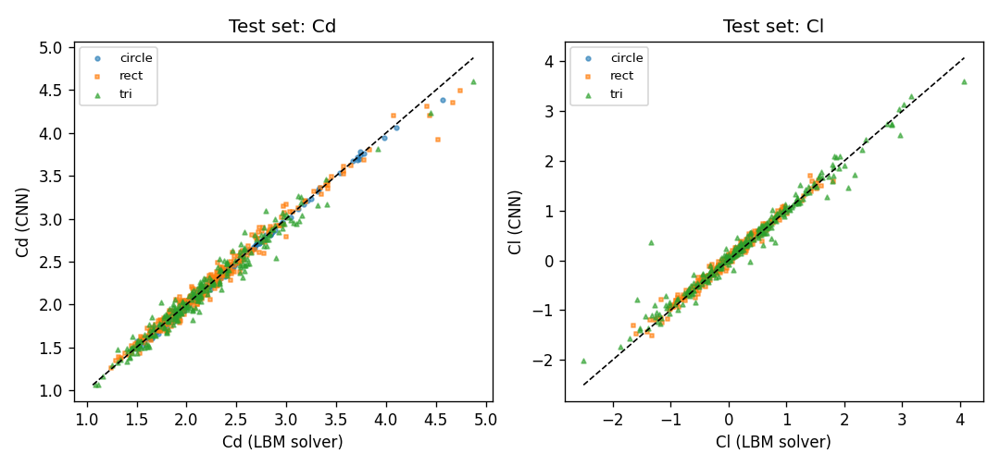

# CFD-Drag-2D: Lattice Boltzmann Solver, Drag Dataset and CNN Surrogate

    

## Overview
A complete, reproducible pipeline from physics to machine learning:

1. **Solver:** a 2D lattice Boltzmann (D2Q9, TRT) flow solver written from scratch in C++ and CUDA,
   validated against the Schäfer–Turek cylinder benchmark.
2. **Dataset:** 5000 random obstacles (circles, rectangles, triangles at any angle, Re 20 to 100)
   solved on two Kaggle T4 GPUs in under an hour, with automatic quality checks.
3. **Surrogate:** a small CNN that predicts drag (Cd) and lift (Cl) from the obstacle shape and Re
   in milliseconds, with a 2.3 % mean Cd error, beating a gradient-boosting baseline that is
   given the exact shape parameters.
4. **Flow Studio:** a desktop app to design an obstacle, see the CNN prediction instantly, and
   check it against the full simulation.


*Flow Studio: the CNN predicts Cd = 2.31 in 2 ms; the solver gives 2.39 after 42 s (3.3 % error).
Vortex shedding behind a rectangle at Re = 60.*

## Features
* **CPU and CUDA engines:** both share one per-node update (`cfd_engine/lbm_common.hpp`). The CUDA
  solver runs hundreds of cases per launch and matches the CPU solver to 10 digits.
* **Correct physics inputs:** Reynolds number as input, time-averaged Cd/Cl after warm-up (vortex
  shedding), projected frontal height as reference length, stability and blockage guards.
* **Reproducible dataset pipeline:** seeded per-case sampling, parallel and resumable generation,
  identical results for any worker count or GPU batch size, dataset checks and a CPU spot check.
* **CNN surrogate:** PyTorch, trained on Kaggle GPUs from a notebook that clones this repository;
  evaluated against mean and gradient-boosting baselines over 3 training seeds.
* **Flow Studio (PyQt6):** live CNN prediction with input validation, full solver run with flow
  field, and dataset generation from the GUI.
* **Tested:** 49 tests, including physics validation, determinism and GPU-vs-CPU agreement.

## Solver
* D2Q9 lattice Boltzmann with TRT collision, half-way bounce-back walls, Zou-He velocity inlet
  (uniform or parabolic) and pressure outlet. The inlet ramps up smoothly from rest.
* Inputs: shape, sizes, angle and **Reynolds number** `Re = U·D/ν`, where `D` is the projected
  frontal height of the rotated obstacle and `U` the mean inlet velocity (0.05 lattice units).
* Outputs (`results.csv` in `--out-dir`): time-averaged **Cd**, **Cl**, lift fluctuation `Cl_rms`,
  pressure loss, a steady/periodic flag, and optionally the mask and flow fields as `.npy`.
* Validated in `tests/`: determinism, mass conservation, channel (Poiseuille) flow, and the
  Schäfer–Turek 2D-1 cylinder benchmark (Cd = 5.58 at Re = 20).

## Status
Complete (milestones M0 to M6). See `SPEC.md` for the specification and `DECISIONS.md` for every
design choice and result.

## Prerequisites
* **C++ Compiler:** GCC/G++ with C++17 support, and `make`.
* **Python:** 3.10+ (3.12 recommended). Dependencies are listed in `requirements.txt`.

## Quick Start
All commands run from the repository root.

```bash
# 1. Build the solver (-> build/solver)
make solver

# 2. Python environment
python -m venv .venv && source .venv/bin/activate
pip install -r requirements.txt -e .

# 3. Flow Studio (GUI); the CNN panel needs the [ml] extra (step 8)
python gui/app.py

# 4. CLI dataset generation (resumable; writes to ./dataset by default)
python scripts/generate.py --n 100 --seed 0 --out dataset --images

# 5. Tests (quick; use `make test-all` to include slow validation tests;
#    GPU tests run only where build/solver_cuda and an NVIDIA GPU exist)
make test

# 6. GPU generation (needs nvcc): build, then use the cuda back-end
make cuda
python scripts/generate.py --n 1000 --seed 0 --backend cuda --out dataset

# 7. Check a dataset (writes summary.json; exits 1 if a check fails)
python scripts/check_dataset.py --data dataset

# 8. CNN surrogate (optional [ml] extra; CPU torch shown)
uv pip install torch --index-url https://download.pytorch.org/whl/cpu && uv pip install -e ".[ml]"
python scripts/train.py --data dataset --out runs/v1        # ~15 s/epoch on CPU, ~1 s on a T4
python scripts/evaluate.py --data dataset --run runs/v1     # metrics.json, predictions.csv, parity.png
```

All tunable defaults (domain size, steps, sampling ranges) live in `cfd_drag/params.py`.

## Output Format
A dataset directory contains:
1. `data.csv`: one row per case with the inputs (`shape`, `size1`, `size2`, `angle`, `re`, frontal height `D`, `blockage`) and the targets (`Cd`, `Cl`, `Cl_rms`, `pressure_loss`), plus `status` (steady/periodic) and `ok`.
2. `masks.npy`: `(N, 64, 64)` uint8 obstacle masks cropped around the obstacle, aligned with `data.csv` rows. These are the CNN inputs.
3. `images/`: optional velocity-magnitude PNGs, for visualisation only.

Load it with `cfd_drag.dataset.load("dataset")`. `example_data/` holds 24 cases.

Throughput: about 6.75 s per case on the development machine (i5-10500T, 6 workers) and 1.4 s per case per Tesla T4 on Kaggle. `notebooks/m3_cuda_check.ipynb` verifies the GPU solver on Kaggle.

## Dataset
`notebooks/m4_generate_dataset.ipynb` generates the full dataset on a Kaggle GPU notebook (2x Tesla T4):
it clones the repository at a fixed commit, runs the tests, solves 5000 cases (seed 0) with the CUDA
solver, re-solves 8 random cases on the CPU as a reproducibility check, and runs `check_dataset.py`.

| | |
|---|---|
| Cases | 5000, all solved cleanly (1671 circles, 1645 rectangles, 1684 triangles) |
| Flow regime | 2757 steady, 2243 vortex shedding |
| Re / frontal height D | 20 to 100 (median 54) / 5 to 24.5 cells |
| Cd (min / median / max) | 0.82 / 2.16 / 5.37 |
| GPU vs CPU re-runs | max relative difference 4e-10 |
| Generation time | 59 min on 2x T4 (0.70 s per case) |
| Size | 21 MB (`data.csv`, `masks.npy`, config and check files) |

The dataset is a private Kaggle dataset for now (link to follow when it is made public).

## Surrogate model
A small CNN (4 conv blocks, 0.26 M parameters) predicts Cd and Cl from the 64x64 obstacle mask;
log(Re) joins in the dense head. It is trained on 3500 cases of the dataset above, the best epoch is
chosen on 750 validation cases, and it is scored once on 750 held-out test cases.
`notebooks/m5_train_surrogate.ipynb` trains it on a Kaggle T4 (about 160 s for 150 epochs).

Test set, CNN as mean ± standard deviation over 3 training seeds (same split):

| Model | Cd MAE | Cd R² | Cd mean rel. error | Cd 95th pct rel. error | Cl MAE | Cl R² |
|---|---|---|---|---|---|---|
| Mean predictor | 0.429 | 0.00 | 20.0 % | 49.9 % | 0.458 | 0.00 |
| Gradient boosting on shape parameters | 0.073 | 0.966 | 3.4 % | 10.2 % | 0.101 | 0.937 |
| **CNN on mask + Re** | **0.051 ± 0.002** | **0.981** | **2.3 ± 0.1 %** | **6.8 %** | **0.060 ± 0.007** | **0.973** |

The CNN sees only pixels and Re, while the gradient-boosting baseline gets the exact shape
parameters; the CNN is still better for every shape and in both flow regimes
(Cd mean relative error: circles 0.8 %, rectangles 2.8 %, triangles 3.4 %; steady 1.8 %,
vortex shedding 2.9 %).

Limits:
- The surrogate error is about as large as the solver's own discretisation error (Cd 2.6 % below
  the Schäfer–Turek benchmark at D = 20 cells), so lower numbers would mostly fit solver artefacts.
- Trained on one channel setup (no-slip walls, blockage up to 25 %, so Cd is above free-stream
  values), three shape families and Re 20 to 100. Other shapes or flow conditions are untested.
- Cl of circles (true value about 0): CNN MAE 0.018 against 0.005 for gradient boosting, which is
  told the shape is a circle; a pixelated circle is not perfectly symmetric.

## Flow Studio
`python gui/app.py`
* **Geometry and flow:** shape, sizes and angle in lattice cells, and the Reynolds number. The
  panel shows the frontal height D, blockage and relaxation time τ, and flags inputs the solver
  rejects (unstable τ, blockage above 25 %) or that lie outside the CNN's training range.
* **CNN prediction (instant):** on every change the app builds the exact 64x64 mask the CNN was
  trained on (one solver step, ~20 ms) and predicts Cd and Cl with `models/surrogate_v1.pt`.
* **Run solver:** the full simulation with the dataset settings (about 40 s on a 6-core desktop CPU), the
  velocity field, Cd, Cl, Cl_rms, flow regime and the CNN's error against the solver.
* **Generate dataset:** the same pipeline as `scripts/generate.py` (seed, size, workers, shapes),
  resumable by choosing the same folder again.
* `python gui/app.py --screenshot docs/gui.png` runs a demo case and saves the screenshot above.



*CNN vs solver on the 750 held-out test cases (training seed 0).*

## Project layout
```
cfd_engine/      C++ and CUDA lattice Boltzmann solvers (shared per-node update)
cfd_drag/        Python package: params, geometry, sampling, dataset pipeline, checks,
                 surrogate (data, model, training, metrics), single-case prediction
scripts/         generate.py, check_dataset.py, train.py, evaluate.py, compare_backends.py
notebooks/       Kaggle notebooks: CUDA check (M3), dataset generation (M4), training (M5)
gui/app.py       Flow Studio
models/          trained surrogate (1 MB)
tests/           pytest suite (`make test` quick, `make test-all` with slow physics validation)
```
